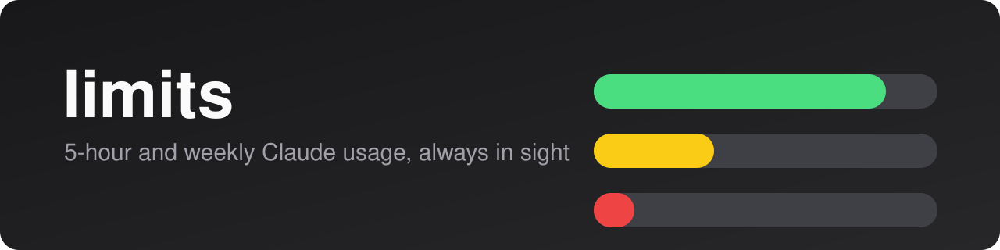
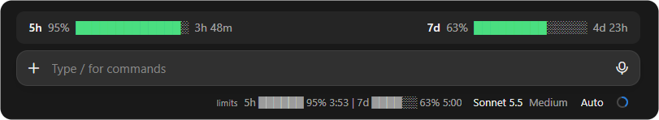
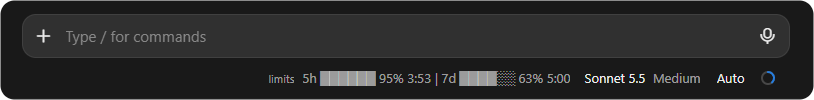
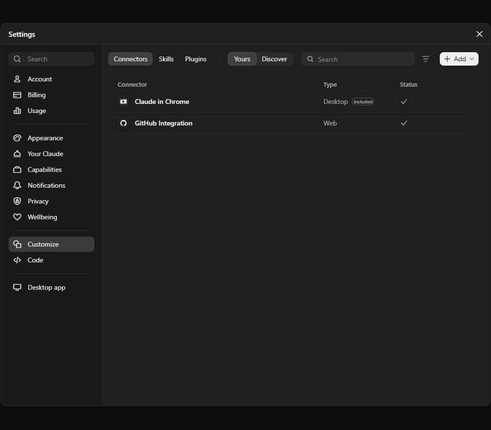

<p align="center">
  
</p>

<p align="center">
  
  
  
</p>

<p align="center">
  See how much of your <b>5-hour</b> and <b>weekly</b> limits is left, and when each one resets,<br>
  without opening a settings page.
</p>

<p align="center">
  <a href="#install">Install</a> ·
  <a href="#usage">Usage</a> ·
  <a href="#how-it-works">How it works</a> ·
  <a href="README.ru.md">Русский</a>
</p>

---

<p align="center">
  
</p>

<p align="center">
  <br>
  <sub>Just the status line, with the band hidden (<code>/limits</code>)</sub>
</p>

## Features

| | |
|---|---|
| **Two windows** | The 5-hour and the weekly limit, side by side. |
| **Percent left** | Not percent used: the number goes down as you work. |
| **Reset countdown** | `h:mm` for the 5-hour limit, `d:hh` for the weekly one (`d:hh:mm` in its last day). |
| **Colour by level** | Green above 50%, yellow from 20 to 50%, red below 20%. |
| **Two places** | A one-line status under the prompt, plus an optional coloured band above it. |
| **Zero setup** | Nothing to configure and no tokens to paste. |

## Install

In a terminal session:

```
/plugin install limits --marketplace KAVALDi/claude-limits-bar
```

From a shell:

```
claude plugin install limits --marketplace KAVALDi/claude-limits-bar
```

In the desktop app, where `/plugin` does not run: open **Settings → Customize → Plugins → Add** and enter `KAVALDi/claude-limits-bar`:

<p align="center">
  
</p>

## Usage

The status line appears by itself after your first reply.

| Command | What it does |
|---|---|
| `/limits` | Shows or hides the coloured band above the prompt (hidden by default). |

## How it works

The mod reads the rate-limit figures Claude already reports for your session and redraws them after every turn. It makes no network requests and stores nothing outside the session.

> [!NOTE]
> Limits exist only on a Claude subscription (Pro or Max). Without one there is nothing to show, and the mod stays silent.

The status line is plain text, so it cannot be coloured or clicked. That is why the coloured version lives in the band.

## Language

Labels are English by default (`5h`, `7d`, `3h 59m`). For Russian (`5ч`, `7д`, `3ч 59м`) set the `language` option to `ru` in the plugin's config menu. Claude does not tell mods the app's interface language, so this is a setting rather than automatic.

## Customise

Bar width and colour thresholds live in [`hooks/register.tsx`](hooks/register.tsx), one small file. Edit and reload.

## License

[MIT](LICENSE)
