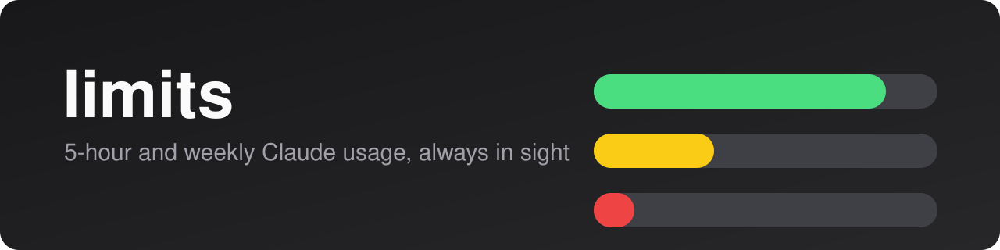
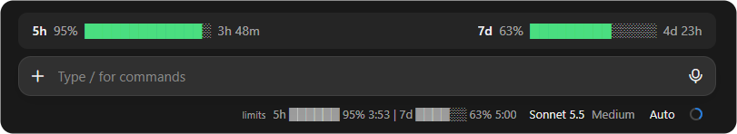
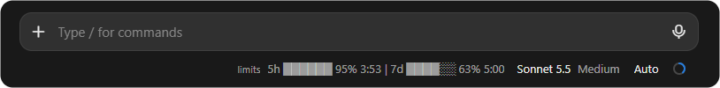
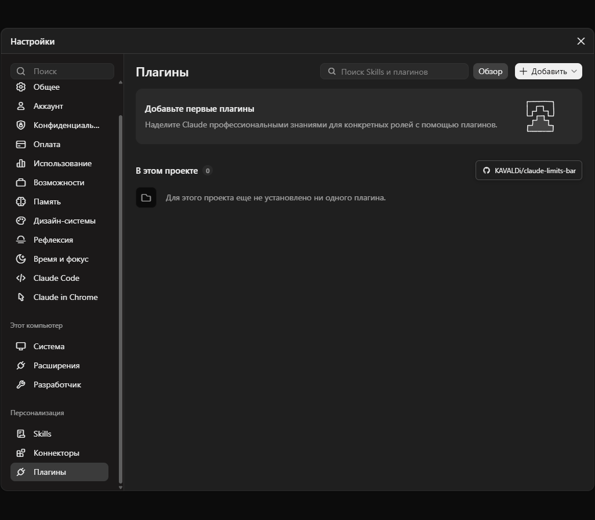

<p align="center">
  
</p>

<p align="center"><a href="README.md">English</a></p>

# limits

Мод для Claude Code и приложения Claude: показывает, сколько осталось от **5-часового** и **недельного** лимитов и когда они сбросятся.

<p align="center">
  
</p>

<p align="center">
  <br>
  <sub>Только строка состояния, когда полоса скрыта (<code>/limits</code>)</sub>
</p>

## Возможности

- Два лимита рядом: 5 часов и неделя.
- Остаток в процентах, а не расход.
- Время до сброса: `ч:мм` для 5 часов, `д:чч` для недели (в последние сутки `д:чч:мм`).
- Цвет по остатку: зелёный выше 50%, жёлтый 20–50%, красный ниже 20%.
- Строка состояния под полем ввода и необязательная цветная полоса над ним.

## Установка

В терминальной сессии:

```
/plugin install limits --marketplace KAVALDi/claude-limits-bar
```

Из shell:

```
claude plugin install limits --marketplace KAVALDi/claude-limits-bar
```

В приложении, где `/plugin` не работает: **Настройки → Персонализация → Плагины → Добавить**, затем укажите `KAVALDi/claude-limits-bar`:

<p align="center">
  
</p>

## Использование

Строка состояния появляется сама после первого ответа. Команда `/limits` показывает или скрывает цветную полосу над полем ввода (по умолчанию скрыта).

> Лимиты есть только на подписке Claude (Pro или Max). Без неё показывать нечего.

## Язык

По умолчанию подписи английские (`5h`, `7d`, `3h 59m`). Чтобы были русские (`5ч`, `7д`, `3ч 59м`), поставьте в настройках мода `language` = `ru`. Приложение не сообщает модам язык своего интерфейса, поэтому автоматически язык не подстраивается.

## Лицензия

[MIT](LICENSE)
